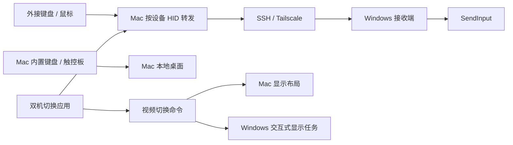

# 双机切换 · Dual Machine Switch

在 Mac 与 Windows 之间共享显示器和外接键鼠，同时让 **Mac 自带键盘、触控板始终留在 Mac**。

这个项目来自一套真实桌面配置：Mac 经 USB-C 扩展坞连接显示器 HDMI，Windows 连接同一显示器的 DP。它把按设备输入转发、Tailscale/SSH 通信和两端视频输出管理组合为一个原生 macOS 应用。

> 当前是面向特定设备开发、经实机迭代的个人项目，不是适配所有显示器的通用即装即用 KVM。其他设备需要配置标识并验证切换行为。

## 能做什么

- **只切换外接设备**：Lofree 外接键盘、X7 外接鼠标可以控制 Windows；内置键盘和触控板继续操作 Mac。
- **切到 Windows**：启用 Windows DP 输出，从 Mac 发送已校准的 DP 指令，再停用 Mac 外接显示输出。
- **切回 Mac**：先停用 Windows DP，再重新启用 Mac HDMI；外接显示器为主屏，内置屏幕为扩展副屏。
- **按设备调整速度**：转发鼠标默认实机配置为 50% 移动倍率，保留小数位移，其他鼠标不受影响。
- **断线释放输入**：外设或连接异常时释放保持的按键，保留当前视频布局，避免重新打开不可见的 Mac 桌面。
- **本地控制**：按键不通过云端服务处理，Windows 接收端只监听回环地址，由 SSH 隧道访问。

## 结构



## 操作方式

| 操作 | 作用 |
|---|---|
| 应用「外接键鼠 → Windows」或 `Ctrl + Option + W` | 外接设备与共享显示器交给 Windows |
| 应用「外接键鼠 → Mac」或 `Ctrl + Option + M` | 外接设备与共享显示器回到 Mac |
| `Ctrl + Shift + Esc` | 备用收回快捷键 |

独立命令只处理视频输出，应用按钮会同步协调输入：

```sh
display-handoff mac          # 停 Windows DP，再开 Mac HDMI
display-handoff windows      # 开 Windows DP，再停 Mac 外接输出
display-handoff restore-dp   # 单独恢复 Windows DP
display-handoff status      # 读取两端软件状态
display-handoff --dry-run    # 查看流程，不改变显示
```

## 构建

macOS 需要 Apple Silicon 和 Xcode Command Line Tools：

```sh
bash macos/build-keyboard.sh
bash tests/run.sh
```

应用输出至 `dist/双机切换.app`。构建不安装应用，不修改正在使用的配置。测试覆盖 DDC 包解析、内置设备排除策略以及断线时的视频模式保护，不切换真实显示器。

Windows 使用自带的 .NET Framework C# 编译器：

```powershell
powershell -NoProfile -ExecutionPolicy Bypass -File scripts\build-windows.ps1
```

首次部署需要设置显示器标识、SSH 别名、配对密钥及后台任务，详见 **[配置与部署](docs/SETUP.md)**。

## 当前适配与边界

- 实机配置：Apple Silicon Mac、LECOO M2732PL、绿联 CM639 扩展坞、Lofree Flow84-L、通过 USB 接收器连接 Mac 的西伯利亚 X7。
- 外设白名单目前写在 `selective-input/Router.m`。其他键鼠需修改匹配条件；Built-In 排除保护必须保留。
- 显示器的读取编号不一定等于可写的切换编号。测试配置的 DP 写入值为 `15`；直接发送 HDMI 指令未可靠生效，因此采用两端输出启停顺序。
- Windows 需处于已登录的交互式桌面会话。不能保证登录界面、UAC 安全桌面或拒绝合成输入的软件。
- 视频输出重新枚举可能改变 Windows 窗口位置。工具拒绝停用 Windows 的唯一或主显示输出。
- Mac 显示启停使用私有 CoreGraphics 接口，系统升级后需要重新验证。
- 本地重新编译可能使 macOS 的旧输入监控授权失效，需要重新授权当前构建。

已在上述设备上确认双向视频流程及应用返回 Mac 的行为。仓库不包含个人运行日志、蓝牙地址、显示器唯一标识、配对密钥和开发缓存；示例配置不代表其他设备的正确输入编号。

## 源码导航

| 路径 | 内容 |
|---|---|
| `macos/SelectiveSwitch.swift` | 原生应用与快捷键 |
| `selective-input/Router.m` | 按外设读取、转发、释放及恢复 |
| `selective-input/WindowsReceiver.cs` | Windows 输入接收与鼠标倍率 |
| `macos/DisplayProfile.m` | Mac 主副屏配置与显示输出启停 |
| `display-handoff` | 两端视频切换编排、请求校验与恢复 |
| `windows/DisplayOutput.cs` | Windows 指定显示输出管理 |
| `windows/VideoCommand.ps1` | 交互式桌面任务入口 |
| `vendor/m1ddc` | 保留许可证的 DDC 工具源码 |

第三方来源和许可见 [THIRD_PARTY_NOTICES.md](THIRD_PARTY_NOTICES.md)。
